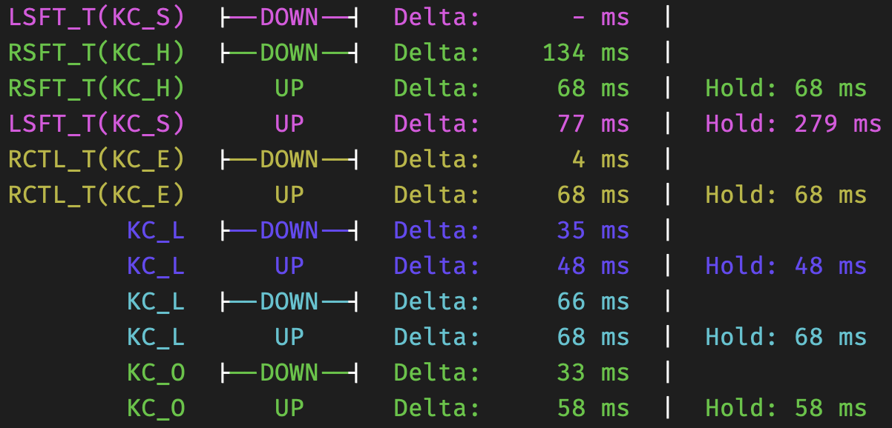

# @dave-thompson's QMK community modules


**Lumberjack**, one of the library's modules, shows you every key you pressed and when.  It helps you debug home-row mods and other timing-dependent features.<br><br>

### HRM Collection

The stuff you're here for. Find the causes of your home-row misfires, install the right modules to fix them, and work out the config settings that are best for you.

| Module                                    | Description                                           |
|-------------------------------------------|-------------------------------------------------------|
| [Lumberjack](./lumberjack/README.md)    | **See which keys you pressed and when.**  Essential for debugging timing-dependent features and finding the right config for your HRMs.<br><br>                                                                                 |
| [Lightshift](./lightshift/README.md)    | **Fast & accurate home-row shifts.**  Easily beats Chordal Hold for typing (but demands care with keyboard shortcuts in return).<br><br>                  |
| [Dropshift](./dropshift/README.md)      | **No more double shifts.**  Turns "THe" into "The". Works with any held shift key.<br><br>                    |

#### Suggested HRM Setup
- **Shift HRMs:** Use [Lightshift](./lightshift) and [Sentence Case](https://getreuer.info/posts/keyboards/sentence-case/index.html). Optionally add [Dropshift](./dropshift) and [Caps Word](https://docs.qmk.fm/features/caps_word).
- **Other HRMs:** Use [Flow Tap](https://docs.qmk.fm/tap_hold#flow-tap) with a high `TAPPING_TERM` (250ms) and a high `FLOW_TAP_TERM` (200ms) so non-shift HRMs never fire while typing. Create **custom hotkeys** for shortcuts like copy/paste that you ***do*** use while typing.
- **Mod-clicks:** Use [Speculative Hold](https://getreuer.info/posts/keyboards/speculative-hold/), configured to your specific system.

**Fine Tuning:** Install [Lumberjack](./lumberjack) and leave it running in the background. On your next misfire, check the Lumberjack log for the cause and adjust the relevant setting (often `LIGHTSHIFT_TAPPING_TERM`) accordingly.

### Other Stuff

| Module                                    | Description                                           |
|-------------------------------------------|-------------------------------------------------------|
| [Switcher](./switcher/README.md)        | **Supercharge your app switcher.**  Fixes the Mac app switcher's many issues. Send Cmd-Tab or Alt-Tab with a single keypress, map navigation and power features to the home row, and a whole lot more.<br><br>         |

## Prerequisites

Your keyboard must be using **QMK Firmware 0.29.0** (released 2025-05-25) or later.

## Installation

Download the code to your computer using one of the two options below, then follow the README instructions for the specific module you'd like to install.

### Option 1

Open a terminal and run the following three commands.  Change `/path/to/qmk_userspace` to the path of your `qmk_userspace`.  (If you don't have an [external userspace](https://docs.qmk.fm/newbs_external_userspace), you can **theoretically** use your `qmk_firmware` folder instead — but an external userspace makes life much easier in the long run.)

```sh
cd /path/to/qmk_userspace
git submodule add https://github.com/dave-thompson/qmk-modules.git modules/dave-thompson
git submodule update --init --recursive
```

### Option 2

Download [qmk-modules-main](https://github.com/dave-thompson/qmk-modules/archive/refs/heads/main.zip) and unzip it.  Rename the resulting `qmk-modules-main` folder to `dave-thompson` and put it in your `modules` folder.

Whichever option you choose, your directory structure should then look like this:

    <qmk_userspace or qmk_firmware>
    └── modules
        └── dave-thompson
            ├── dropshift
            ├── lightshift
            ├── lumberjack
            ├── switcher
            └── ...

## License

This repo uses the GNU GPLv3 except where otherwise indicated. See the [LICENSE file](LICENSE.txt) for details.