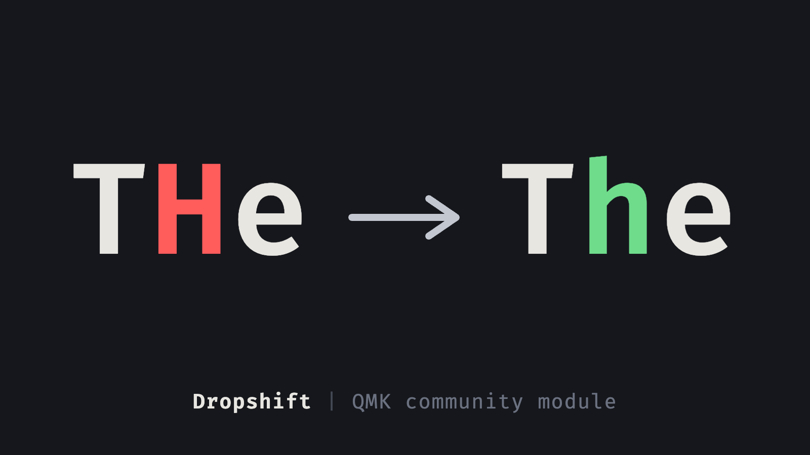
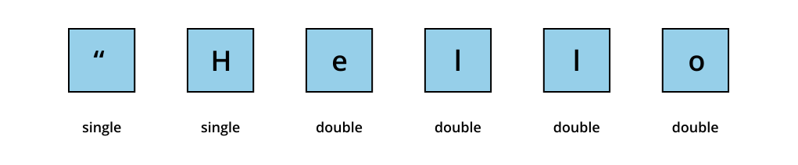
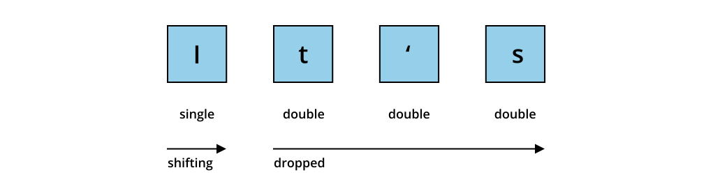

<div align="center">
    <picture>
        
    </picture>
</div>

## Contents

<table>
<tr><td><b>Module</b></td><td><tt>dave-thompson/dropshift</tt></td></tr>
<tr><td><b>Version</b></td><td>2026-11-13</td></tr>
<tr><td><b>Maintainer</b></td><td>Dave Thompson (@dave-thompson)</td></tr>
<tr><td><b>License</b></td><td><a href="../LICENSE.txt">GNU GPLv3</a></td></tr>
</table>

**Core** • [Fixing Double Shifts](#fixing-double-shifts) • [How it Works](#how-it-works)

**Setup** • [Installation](#installation) • [Caps Word](#caps-word) • [Singles & Doubles](#singles--doubles)

**Reference** • [Appendices](#appendix-a-resource-requirements)

## Fixing Double Shifts

Ever typed **"THe"** instead of **"The"**?

**Dropshift** fixes accidental double shifts.  It works with any held shift key, including mod-taps, [lightshifts](../lightshift) and (held) one-shots.

## How it Works

After capitalising a letter, Dropshift "consumes" the shift so that no second letter is shifted, even with the shift key held down.

Outside capitalisation, shift works normally.  You can shift-click, type punctuation, send keyboard shortcuts, and shift-select with arrow keys — all multiple times.

### Acronyms

To type multiple capitals in a row, such as "HTML", you can either release and reapply shift between letters, or use Caps Word (see [below](#caps-word)).

### Comparison to One-Shot Shift

One-shot shift is a key that's often great, but not always.  It isn't compatible with Mod-Taps / HRMs, it doesn't shift-click well, it isn't smart about punctuation, and it sometimes shifts keys you didn't intend to.

Dropshift is a ***mode*** for your existing shift key — you keep all the functionality you're used to, just without the double shifts.


## Setup

### Installation

Add `dave-thompson/dropshift` to your `keymap.json` and all your shift keys stop double shifting straightaway.  (If you don't yet have a `keymap.json`, create one with the below content in the same folder as your `keymap.c` file.)

```json
{
    "modules": ["dave-thompson/dropshift"]
}
```

### Caps Word

Caps Word (or Caps Lock) is near mandatory when using Dropshift, since you can't capitalise multiple letters by holding shift.  Dropshift enables Caps Word automatically; just assign the `CW_TOGG` keycode to a key (or combo) in your keymap — or for more options, see [Caps Word](https://docs.qmk.fm/features/caps_word).

If you'd rather not have Caps Word, disable it in `rules.mk`:

```makefile
CAPS_WORD_ENABLE = no
```

### Singles & Doubles

Dropshift categorises keys pressed during a shift into singles and doubles.  The first shiftable key is always a single.  Once that single is 'consumed', all subsequent keys are considered doubles.  By default, only letters (A-Z) consume the single shift.

<div align="center">
    <picture>
        <source media="(prefers-color-scheme: light)" srcset="doc/hello-light.svg">
        <source media="(prefers-color-scheme: dark)" srcset="doc/hello-dark.svg">
        
    </picture>
</div>


On ***letter*** doubles, shift is dropped until re-pressed.

<div align="center">
    <picture>
        <source media="(prefers-color-scheme: light)" srcset="doc/its-light.svg">
        <source media="(prefers-color-scheme: dark)" srcset="doc/its-dark.svg">
        
    </picture>
</div>

On ***non-letter*** doubles, shift continues.

<div align="center">
    <picture>
        <source media="(prefers-color-scheme: light)" srcset="doc/q-light.svg">
        <source media="(prefers-color-scheme: dark)" srcset="doc/q-dark.svg">
        
    </picture>
</div>

You can change which keys consume the single, and which keys drop shift on a double, by defining `dropshift_consume_single()` and / or `dropshift_allow_double()` in `keymap.c`.

```c
bool dropshift_consume_single(uint16_t keycode, const keyrecord_t *record) {

    // consume shift when typing @, preventing @Jess when intending @jess
    // (@ is a shifted KC_2)
    if (keycode == KC_2) return true;

    // fallback to the default implementation for other keycodes
    return dropshift_consume_single_raw(keycode, record);
}
```

```c
bool dropshift_allow_double(uint16_t keycode, const keyrecord_t *record) {

    // prevent accidental double-quote when typing: I"ve
    // (double quote is a shifted single quote, aka KC_QUOTE)
    if (keycode == KC_QUOTE) return false;

    // fallback to the default implementation for other keycodes
    return dropshift_allow_double_raw(keycode, record);
}
```

## Appendix A: Resource Requirements

### Firmware Sizes
Dropshift is ~550 bytes.  Caps Word (automatically enabled with Dropshift) is ~400 bytes and its useful `CAPS_WORD_INVERT_ON_SHIFT` option is ~200 bytes.

### RAM Usage
Dropshift uses ~10 bytes of static RAM.

## Appendix B: Development

### State Machine
The state machine is documented in [dropshift.c](./dropshift.c).  All state transitions occur in `process_record()`, once QMK has decided whether mod-taps are tapped or held.

### Debugging
For debug output including state transitions and shift drop decisions, define `DROPSHIFT_DEBUG` in `config.h`.  Also install [Lumberjack](../lumberjack) and define `LUMBERJACK_PR` in `config.h` to log process\_record events.

### Linking from Other Modules
Check for the `DROPSHIFT_ENABLE` definition to see if Dropshift is installed.
