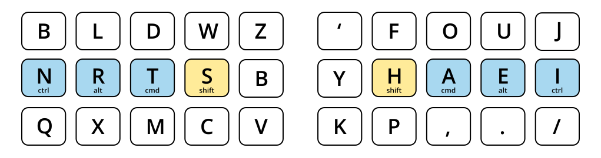
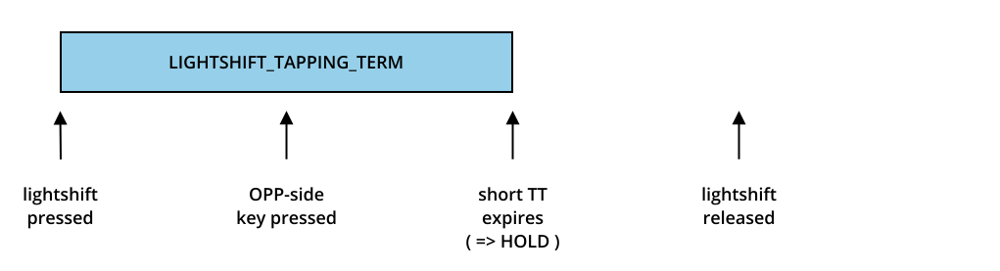
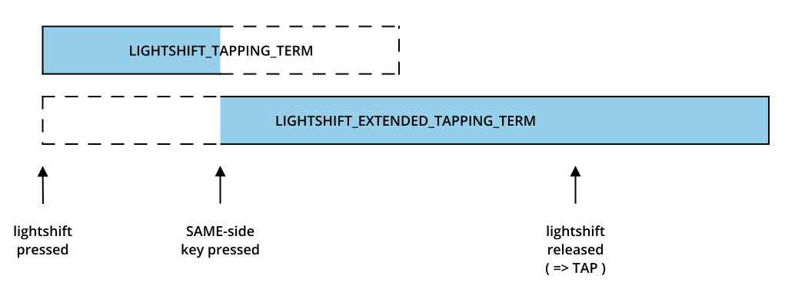
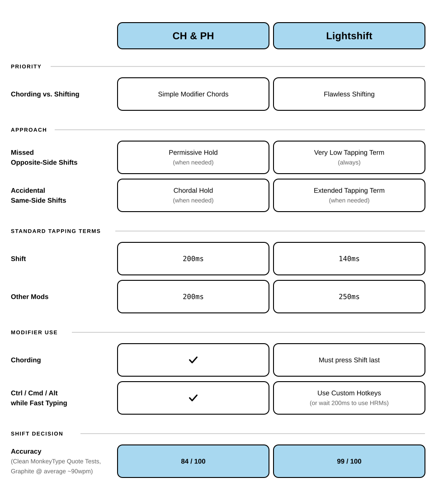

# Lightshift

<table>
<tr><td><b>Module</b></td><td><tt>dave-thompson/lightshift</tt></td></tr>
<tr><td><b>Version</b></td><td>2026-11-12</td></tr>
<tr><td><b>Maintainer</b></td><td>Dave Thompson (@dave-thompson)</td></tr>
<tr><td><b>License</b></td><td><a href="../LICENSE.txt">GNU GPLv3</a></td></tr>
</table>

## Contents

**Core** • [Misshifts Fixed](#misshifts-fixed) • [How It Works](#how-it-works) • [Chording](#important-chording)

**Configuration** • [Quick Start](#quick-start) • [Suggested Setup](#suggested-setup) • [Tapping Term](#lightshift-tapping-term) • [Handedness](#handedness)

**Other Modules** • [Interfaces](#interfaces) • [Chordal Hold](#comparison-to-chordal-hold) • [Other Alternatives](#other-alternatives)

**Reference** • [Troubleshooting](#troubleshooting) • [Appendices](#appendix-a-full-list-of-parameters-and-options)

## Home-Row Shifts at Speed

Home-row mods have improved a lot, yet **shift** is still a problem — it's used too quickly, too frequently, and in the middle of the typing flow.

**Lightshift** transforms your home-row shift keys, using Chordal Hold's handedness concept but with much stricter rules that work **even at speed**.  It delivers near-flawless shifting while typing, and asks in exchange only a tiny [bit of care](#important-chording) with modifier chords.

[Initial setup](#quick-start) is zero-config.  You can use Lightshift standalone or stacked with Chordal Hold, Flow Tap and so on — it plays nicely with QMK at large.

## Misshifts Fixed

<div align="center">
    <picture>
        <source media="(prefers-color-scheme: light)" srcset="doc/graphite-light.svg">
        <source media="(prefers-color-scheme: dark)" srcset="doc/graphite-dark.svg">
        
    </picture>
    <br>
    <i><b>Graphite:</b> A modern layout with frequently used keys on the home row, making it vulnerable to misshifts</i>
</div>

### 1. Accidental Same-Side Shifts

Modern layouts put the most used letters on the home row.  Common trigrams, like "str" on Graphite, are easily typed rolls.  But the hand's biomechanics cause rolled keys to be held for longer, leading to accidental shifting.  Then **"string"** becomes **"TRing".**

### 2. Missed Opposite-Side Shifts

Core home-row solutions like Chordal Hold require the use of high tapping terms and a measured, staccato typing style.  When typing speed goes up, those tapping terms are missed and that measured style is lost.  Then **"I"** becomes **"si".**

## How it Works

The fundamental problem is that certain **same-side** **taps** naturally take longer than **opposite-side** **holds**.  That's just the hand's biomechanics.  No single tapping term can fix this — the ranges overlap.

Lightshift combats this with two different tapping terms.  A very short **Lightshift Tapping Term** of 140ms eliminates Missed Opposite-Side Shifts.

<div align="center">
    <picture>
        <source media="(prefers-color-scheme: light)" srcset="doc/opp-light.svg">
        <source media="(prefers-color-scheme: dark)" srcset="doc/opp-dark.svg">
        
    </picture>
</div>

However, if you press another same-side key within the tapping term, as in a roll like "str", the **Extended Tapping Term** kicks in.  This is an enormous 65,535ms, eliminating Accidental Same-Side Shifts.

<div align="center">
    <picture>
        <source media="(prefers-color-scheme: light)" srcset="doc/same-light.svg">
        <source media="(prefers-color-scheme: dark)" srcset="doc/same-dark.svg">
        
    </picture>
</div>

## Important: Chording

**Lightshift takes no mercy on misshifts — not even for modifier chords.**

✅ **:** Ctrl → Shift → N

❌ **:** Shift → Ctrl → N **[ ==> types "hin" ]**

If chording a lightshift with other (same-side) modifiers, the lightshift must always be the ***last*** modifier pressed, otherwise you will type letters instead.  It's a quick adjustment, and well worth it for home-row shifts at speed.

**Tip:** Put shift on your **index** finger — chorded mods become an easy inward roll.

## Quick Start

Add `dave-thompson/lightshift` to your `keymap.json` and all your mod-tap shifts become lightshifts straightaway.  Take her for a test flight!

```json
{
    "modules": ["dave-thompson/lightshift"]
}
```

(If you don't yet have a `keymap.json`, create one with the above content in the same folder as your `keymap.c` file.)

## Configuration Guide

### Suggested Setup

Lightshift is best used as part of a wider HRM setup — see the [suggested setup](../README.md#suggested-hrm-setup) in the repo root.

Lightshift avoids direct manipulation of the event flow, making it compatible with a wide range of QMK features and modules, including Combos, Speculative Hold, Sentence Case, Custom Shift, Flow Tap, Chordal Hold and Permissive Hold.

### Lightshift Tapping Term
Set `LIGHTSHIFT_TAPPING_TERM` in `config.h`: aim for the highest value that ***never*** causes a missed opposite-side shift.  Use [Lumberjack](../lumberjack) to find your personal opposite-side shift times.

```c
#define LIGHTSHIFT_TAPPING_TERM 120            // default is 140
```

### Handedness

Lightshift takes its best guess at which hand you use for which keys, or if you're already using Chordal Hold, Lightshift will automatically use its definition instead.

To customise handedness, define `chordal_hold_layout[][]` in your `keymap.c`, based on your existing base layer definition:

```c
// Example existing layer definition on which to base your chordal_hold_layout[][]
[0] = LAYOUT_MY_KEYBOARD(
     KC_Q,    KC_W,    KC_E,    KC_R,    KC_T,     KC_Y,    KC_U,    KC_I,    KC_O,    KC_P,
     KC_A,    KC_S,    KC_D,    KC_F,    KC_G,     KC_H,    KC_J,    KC_K,    KC_L,    KC_ENT,
     KC_Z,    KC_X,    KC_C,    KC_V,    KC_B,     KC_N,    KC_M,    KC_COMM, KC_DOT,  KC_SLSH,

                                MO(1),   KC_BSPC,  KC_SPC,  MO(2)
  ),
```
```c
// chordal_hold_layout[][] definition to add to your keymap.c
// - change LAYOUT_MY_KEYBOARD to match the layout name in your layer definition
// - add 'L' or 'R' for each of your keys (or '*' for keys you use with both hands)
const char chordal_hold_layout[MATRIX_ROWS][MATRIX_COLS] PROGMEM =
  LAYOUT_MY_KEYBOARD(
     'L',    'L',    'L',    'L',    'L',     'R',    'R',    'R',    'R',    'R',
     'L',    'L',    'L',    'L',    'L',     'R',    'R',    'R',    'R',    'R',
     'L',    'L',    'L',    'L',    'L',     'R',    'R',    'R',    'R',    'R',

                             'L',    'L',     'R',    'R'
  );
```
Alternatively, you can define handedness functionally, as below.  Note that 'col' and 'row' here refer to your board's electrical matrix rather than your physical keys, which can make the terms somewhat unintuitive.  If you don't know the col / row positions of your keys, use [Lumberjack](../lumberjack)'s `#define LUMBERJACK_PR` option to find them.

```c
char chordal_hold_handedness(keypos_t key) {
    return key.row < MATRIX_ROWS / 2 ? 'L' : 'R';
}
```

## Interfaces

Lightshift hooks into several parts of QMK to implement Extended Tapping Term — and to automatically disable Flow Tap, Chordal Hold and Permissive Hold on lightshift keys.  If you're using any of the below hooks in your own code, you'll need to tweak your implementations for compatibility.

### Per-Key Tapping Terms

If you have a custom `get_tapping_term()` implementation, define `LIGHTSHIFT_USER_TAPPING_TERM` in `config.h`, then update your implementation to call lightshift's Extended Tapping Term hook.

```c
uint16_t get_tapping_term(uint16_t keycode, keyrecord_t *record) {

    // add this line at the top
    if (is_lightshift(keycode)) return get_lightshift_term(keycode, record);

    // your custom code goes here
    ...
}
```

### Flow Tap

If you have a custom `get_flow_tap_term()` implementation, define `LIGHTSHIFT_USER_FLOW_TAP` in `config.h`, then update your implementation to call lightshift's hook.

```c
uint16_t get_flow_tap_term(uint16_t keycode, keyrecord_t* record, uint16_t prev_keycode) {
                      
    // add this line at the top (so flow tap remains disabled on lightshift keys)
    if (is_lightshift(keycode)) return 0;

    // your custom code goes here
    ...
}
```

### Chordal Hold

If you have a custom `get_chordal_hold()` implementation, define `LIGHTSHIFT_USER_CHORDAL_HOLD` in `config.h`, then update your implementation to call lightshift's hook.

```c
bool get_chordal_hold(uint16_t tap_hold_keycode,
                      keyrecord_t* tap_hold_record,
                      uint16_t other_keycode,
                      keyrecord_t* other_record) {
                      
    // add this line at the top (so chordal hold remains disabled on lightshift keys)
    if (is_lightshift(tap_hold_keycode)) return true;
    
    // your custom code goes here
    ...
}
```

### Permissive Hold

If you have a custom `get_permissive_hold()` implementation, define `LIGHTSHIFT_USER_PERMISSIVE_HOLD` in `config.h`, then update your implementation to call lightshift's hook.

```c
bool get_permissive_hold(uint16_t keycode, keyrecord_t *record) {
                      
    // add this line at the top (so permissive hold remains disabled on lightshift keys)
    if (is_lightshift(keycode)) return false;

    // your custom code goes here
    ...
}
```

## Comparison to Chordal Hold

Lightshift was inspired by the excellent [Chordal Hold](https://docs.qmk.fm/tap_hold#chordal-hold). Chordal Hold aims to fix accidental same-side shifts, and is usually paired with Permissive Hold which aims to fix missed opposite-side shifts.

Chordal Hold prioritises easy modifier chording over shifting accuracy.  It lets through some misshifts as a result, but it allows Ctrl / Cmd / Alt while typing and requires no change to the way you press modifier chords.

<div align="center">
  <picture>
    <source media="(prefers-color-scheme: dark)" srcset="doc/table-dark.svg">
    
  </picture>
</div>

## Other Alternatives

[SMTD](https://github.com/stasmarkin/sm_td) makes the tap-hold decision using key **release** timing, rather than key **hold** timing and **handedness**.  It's popular with people without split boards who don't want to worry about using the correct-sided shift key.  Rather than extending QMK's standard MT keys, it reinvents mod-tap from the ground up. This fully custom approach buys good accuracy at the price of complex setup and low compatibility with other QMK features.  There are some issues with combos, high-speed typing, and rolled keys.

There's also [Predictive Tap-Hold](https://github.com/jgandert/qmk_modules/tree/main/predictive_tap_hold), which runs a trained decision tree in your firmware!

## Troubleshooting

### I'm still getting misshifts!!!  😭

The best thing to do, before twiddling a thousand settings, is to work out why.  Install [Lumberjack](../lumberjack), a keylogger that tracks exactly which keys you pressed and when, and leave it running in the background while you type.  Then next time you have a misshift, check it to see what happened.

#### a. Missed Opposite-Side Shifts
Did you **hold** shift for less than `LIGHTSHIFT_TAPPING_TERM`?  If so, reduce `LIGHTSHIFT_TAPPING_TERM` to just under that hold time.

#### b. Accidental Same-Side Shifts
Was the **delta** between the shift press and the subsequent, same-side press greater than `LIGHTSHIFT_TAPPING_TERM`?  This is unusual, but if you're new to typing and slow, you may need to temporarily increase `LIGHTSHIFT_TAPPING_TERM` until you speed up.

#### c. Missing Letters at the End of Words, or with Thumb Keys
An accidental same-side shift in disguise!  Do you have Space on a thumb key?  Is its handedness `L/R` or `*`?  Pressing a home-row key then a same-side thumb key causes the home-row key to be pressed longer than usual — it should be treated as a same-side roll.  If your thumb key has `*` handedness, change it to `L/R`.

(If you're using Lightshift and Chordal Hold together, and want to use `L/R` for lightshift but `*` for Chordal Hold, then define both `lightshift_handedness()` and `chordal_hold_handedness()`.  Each module will use its own handedness definition.)

#### d. Misshifts just after Layer Switching
Does Lumberjack show a non-shift keycode that you thought was a shift key?  If you shift within ~200ms of layer switching with an LT key, QMK passes Lightshift the wrong keycode, so Lightshift ignores it.  Fix this by ensuring all MT Shift keys on the switched-to layer are also MT Shift keys on the switched ***from*** layer.

## Appendix A: Full list of Parameters and Options

#### In config.h

<table>
<tr><td><b>Parameter</b></td><td><b>Effect</b></td></tr>

<tr><td><tt>LIGHTSHIFT_TAPPING_TERM</tt></td><td>Adjusts the opposite-side tapping term.  Default: 140ms.</td></tr>
<tr><td><tt>LIGHTSHIFT_EXTENDED_TAPPING_TERM</tt></td><td>Adjusts the extended (same side) tapping term.  Default: 65,535ms.</td></tr>

<tr><td><tt>LIGHTSHIFT_USER_TAPPING_TERM</tt></td><td>Allows a custom implementation of <tt>get_tapping_term()</tt>.</td></tr>
<tr><td><tt>LIGHTSHIFT_USER_FLOW_TAP</tt></td><td>Allows a custom implementation of <tt>get_flow_tap_term()</tt>.</td></tr>
<tr><td><tt>LIGHTSHIFT_USER_CHORDAL_HOLD</tt></td><td>Allows a custom implementation of <tt>get_chordal_hold()</tt>.</td></tr>
<tr><td><tt>LIGHTSHIFT_USER_PERMISSIVE_HOLD</tt></td><td>Allows a custom implementation of <tt>get_permissive_hold()</tt>.</td></tr>

</table>

## Appendix B: Resource Requirements

### Firmware Sizes
Lightshift is ~975 bytes.  Handedness configurations can affect firmware size by up to 300 bytes.  For the smallest possible firmware, define a custom `chordal_hold_handedness()`.

### RAM Usage
Lightshift uses ~11 bytes of static RAM, and ~30 bytes of stack.

## Appendix C: Development

### State Machine
The state machine is documented in [lightshift_tracking.c](./lightshift_tracking.c).

### Debugging
For debug output including state transitions, tapping term decisions and hold resolutions, define `LIGHTSHIFT_DEBUG` in `config.h`.  Lumberjack is also useful to log pre\_process\_record events.

Debugging is RAM intensive (~100 bytes).  An AVR board which misbehaves on enabling debug is likely experiencing stack overflow: temporarily uninstall other features to free up RAM until you finish debugging.

### Linking from Other Modules
Check for the `LIGHTSHIFT_ENABLE` definition to see if Lightshift is installed.

<p align="right">
<i>lightshift: zero mercy for misshifts</i>
</p>